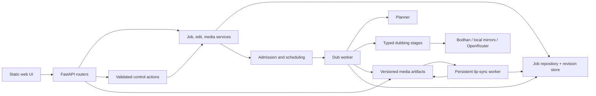
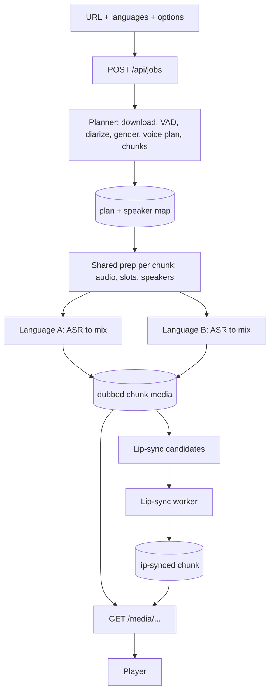
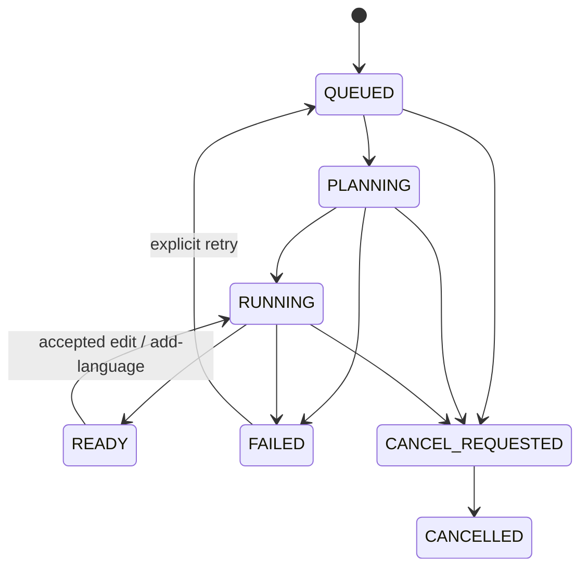
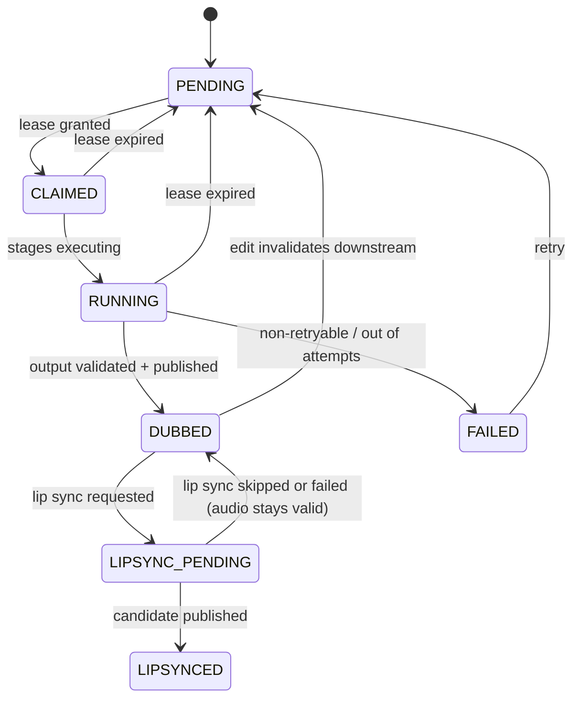

# Architecture

SunwAI is one Python package (`src/sunwai`), one FastAPI application, and separate worker processes. Job state lives on the filesystem. GPU models are loaded inside workers, never at import time.

Dependency rule: routers, then services, then domain modules, then clients and storage. Domain modules never import FastAPI. There is no plugin framework and no dependency-injection container; `bootstrap.py` is a small composition root.

## Components



| Component | Package | Responsibility |
|---|---|---|
| Web UI | `web/` | Player, transcript editing, language switching, action previews and chat. No framework. |
| API | `server/` | App factory, routers, services, public schemas. Translates domain errors to HTTP. |
| Control plane | `control/` | One validated action path (`ActionService`) used by buttons, transcript edits and chat; append-only revision/event store; auth, rate limits, spend caps. |
| Jobs | `jobs/` | Job, language-track and chunk records; repository; pure transition rules; admission and priority; language scheduling; restart recovery. |
| Planning | `planning/` | VAD, diarization, speaker vetting, gender, voice plan, chunk boundaries, plan signature. |
| Pipeline | `pipeline/` | Stage protocol, runner (cache, retry, cancellation, timing), explicit workflow, stages, fitting, synthesis, mixing. |
| Lip sync | `lipsync/` | Face tracking, gates, LatentSync adapter, paste-back, publication checks. |
| Clients | `clients/` | ASR, MT, TTS, LID and LLM protocols with Bodhan, local-mirror and OpenRouter adapters; yt-dlp adapter. |
| Storage | `storage/` | Atomic publication, validated paths, locks, manifests, artifact cache. |
| Workers | `workers/` | Dub worker, lip-sync worker, leases, cross-process resource limits, process-group control. |

## Data flow



Per chunk and language, the stage order is:

`fetch → audio → separate → vad → slots → speakers → asr → mt → fit → numbers → tts → mix → output`

Language-independent work (source cut, audio, separation, slots) is shared across target languages. The workflow in `pipeline/workflow.py` is an explicit, typed sequence of calls, not a list of untyped stages. Lip sync runs afterwards in its own worker and is not a stage of the dub workflow.

## State machines

Three levels are tracked separately: job, language track, chunk. Lip-sync readiness is independent of dubbed-media readiness.

### Job



`READY` means the currently requested work satisfies the readiness policy; partially playable ranges are reported separately. Recovery reclaims expired work through events, not by resetting status fields.

### Chunk (per language)



The chunk diagram is a conceptual summary; the authoritative states are in `jobs/state.py`.

## Stage interface

```python
class Stage(Protocol[InT, OutT]):
    name: str
    version: str
    policy: StagePolicy  # max_attempts, retry_backoff_s, timeout_s, cacheable

    def cache_key(self, value: InT, ctx: ChunkContext) -> str: ...
    def run(self, value: InT, ctx: ChunkContext) -> OutT: ...
    def validate(self, value: OutT, ctx: ChunkContext) -> None: ...
```

`ChunkContext` is immutable (job, language, chunk index, plan signature, generation, revision, work directory, settings, deadline, cancellation token). Clients are injected into stage constructors; the context is not a service locator.

The runner (`pipeline/runner.py`):

- builds cache keys from input digests, stage and config versions, model versions, language, voice/style and plan/revision identity;
- validates cached artifacts rather than trusting file existence;
- writes into attempt-local paths and publishes artifacts and manifest atomically under ownership checks;
- retries only classified transient failures, within one deadline (HTTP retries belong to the clients);
- records cache hits, queue wait, attempts, execution time and degraded outcomes separately;
- checks cancellation before expensive work and before publication, so a superseded revision never becomes current output.

Results that are degraded (`FitResult`, `RepairResult`, `GateDecision`) carry a reason; failures are not silently replaced by apparently successful output.

## Worker model

- **API process**: asynchronous, owns admission and the control plane. Run a single instance for now (filesystem jobs and in-memory guards).
- **Dub work**: admitted chunk processes, scheduled by focus (what the viewer is watching), lookahead and missing work. Cross-process limits cap concurrent ASR, MT and TTS calls.
- **Lip-sync worker**: one persistent process per GPU holding LatentSync and SyncNet in memory. It claims candidates with a lease, sends heartbeats, and publishes only if its lease, generation and revision are still current.
- **Leases**: claim, heartbeat, expiry and fencing tokens (`workers/leases.py`). An expired lease is reclaimed through a recovery event.
- **Processes**: child processes run in their own process groups so timeouts and cancellation kill the whole group; orphans are swept on startup.

## Revisions, fencing and restart

Edits, undo and expression changes create new revisions in an append-only store kept separate from job snapshots. Operation records plus reconciliation tie the two together; there is no multi-file transaction. Idempotency keys make duplicate submissions safe. On restart the server reconciles interrupted edits, reclaims expired leases and resumes jobs that still need work.

## Live controls

Buttons, transcript edits and the chat planner all go through `ActionService.submit()`. LLM tool calls are treated as untrusted input: arguments are validated against shared schemas, authorised, and bound to expiring confirmation tokens where needed. Missing control authentication disables control startup; it never bypasses authentication. Adding a language mid-watch schedules the chunks ahead of the playback position first (the runway), then the rest.

## Status of the extraction

The package layout above is the target. What exists today:

- `core/`, `clients/`, `pipeline/` (Stage protocol, runner, workflow, stages), `lipsync/`, `control/`, `server/`, `workers/`,
  `planning/`, `jobs/` and `mirrors/` are in place and covered by offline tests.
- `storage/`, `media/`, `language/` and the typed job repository are planned; their logic currently lives inside the engine
  and server modules and is being moved out module by module with tests kept green at each step.
- Items in the sections above that name `jobs/state.py`, `workers/leases.py`, `ActionService.submit()` guards and artifact
  manifests describe the target behaviour; the filesystem formats used today are unchanged from the prototype.
